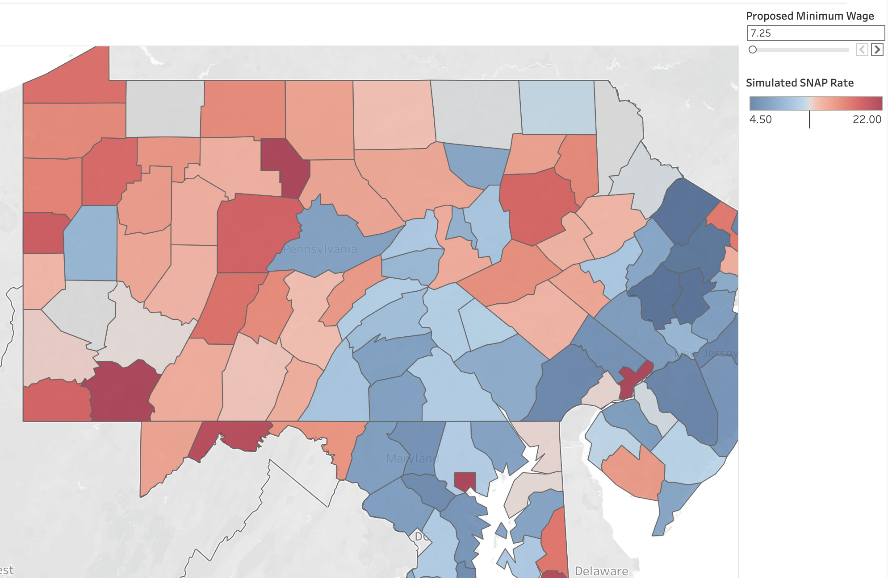

# Tri-State Economic Policy & Welfare Analysis

An analysis of how minimum wage levels, local rent, income, and unemployment relate to SNAP participation across **112 counties in Pennsylvania, New Jersey, and Maryland**.

<a href="https://public.tableau.com/views/interstate_welfare/Sheet1" target="_blank">
  
</a>

## Headline Finding: Lancaster County, PA

| Measure | Value |
|---|---|
| Median monthly gross rent | $1,221 |
| Median household income | $81,458 |
| SNAP household participation rate | 8.11% |
| Annual gross income needed to afford median rent at 30% of income | $48,840 |
| Hourly wage required (40 hrs/week, 52 weeks) | **$23.48/hr** |
| Pennsylvania statutory minimum wage | $7.25/hr |

**Calculation:** `($1,221 × 12) ÷ 0.30 ÷ 2,080 hours = $23.48/hr`

This is an affordability calculation based on the common guideline that housing should cost no more than 30% of gross income. It comes from the Census rent figure directly, not from the machine learning or regression models below.

**Related repository:** [lancaster-min-wage-crisis](https://github.com/ea120-bit/lancaster-min-wage-crisis) is a companion Lancaster County case study that uses SQL and R with HUD and MIT Living Wage Calculator data. This repository uses Census ACS data only.

---

## Data

All data comes from the **U.S. Census Bureau American Community Survey (ACS) 5-year estimates, 2022**, pulled with the Python `census` package. Unit of analysis: county (n = 112: 67 PA, 21 NJ, 24 MD).

| Column | Definition | ACS table |
|---|---|---|
| `median_gross_rent` | Median gross rent (monthly, $) | B25064 |
| `median_income` | Median household income ($) | B19013 |
| `labor_force`, `unemployed_count` | Civilian labor force and unemployed count | B23025 |
| `snap_households`, `total_households` | Households receiving SNAP, and all households | B22003 |
| `snap_participation_rate` | `snap_households / total_households × 100` | derived |
| `unemployment_rate` | `unemployed_count / labor_force × 100` | derived |
| `minimum_wage` | State statutory minimum wage assigned to each county: PA $7.25, NJ $13.00, MD $12.50 | manually assigned |
| `wage_to_rent_ratio` | `minimum_wage / median_gross_rent` | derived |

## Repository Contents

| File | Description |
|---|---|
| `simulate_policy.py` | Pulls Census data, builds the dataset, trains a Random Forest, runs the Lancaster what-if simulation |
| `welfare_regression.R` | OLS regression with coefficient significance tests |
| `real_interstate_welfare_data.csv` | Final 112-county dataset (output of `simulate_policy.py`) |
| `real_pa_welfare_data.csv` | Earlier Pennsylvania-only version of the dataset (67 counties) |
| `dashboard_preview.png` | Preview of the Tableau dashboard |

## Methods

### 1. Random Forest Regressor (Python, scikit-learn)
- **Outcome:** `snap_participation_rate`
- **Features:** `median_gross_rent`, `median_income`, `unemployment_rate`, `wage_to_rent_ratio`
- **Validation:** 80/20 train/test split (`random_state=42`), so 23 counties are held out.
- **Result:** held-out R² = **0.82**, MAE ≈ 1.7 percentage points.
- **Robustness check:** with a single 23-county test set the estimate is noisy. 5-fold cross-validation gives a mean R² of about **0.67** (folds range 0.53 to 0.77), which is the more conservative estimate of out-of-sample performance.

### 2. OLS Regression (R)
`snap_participation_rate ~ wage_to_rent_ratio + median_income + unemployment_rate`

| Variable | Coefficient | p-value |
|---|---|---|
| `median_income` | -1.52e-04 | < 0.001 |
| `unemployment_rate` | +1.04 | < 0.001 |
| `wage_to_rent_ratio` | +261.9 | 0.072 |

Multiple R² = **0.70** (adjusted R² = 0.69), n = 112. Median income and unemployment are strongly associated with SNAP participation. The wage-to-rent ratio is **not** statistically significant at the 5% level.

### 3. Lancaster What-If Simulation
`simulate_policy.py` raises Lancaster's median income by the full-time earnings gain from a higher hypothetical wage, then asks the trained Random Forest to predict SNAP participation. This is a scenario illustration, not a causal estimate (see Limitations).

### 4. Interactive Dashboard (Tableau Public)
A parameter slider lets a user choose a hypothetical minimum wage and compare it against each county's 30%-of-income housing affordability threshold.

## Limitations

- **Association, not causation.** All models are cross-sectional. They describe how counties differ, not what would happen if a minimum wage changed.
- **Minimum wage takes only three values** (PA $7.25, NJ $13.00, MD $12.50), so it is effectively a state indicator. The data cannot isolate the effect of wage changes from other differences between states.
- **`wage_to_rent_ratio` is mostly rent.** Within a state it varies only through rent, and it is correlated with `median_gross_rent`, which is also a feature.
- **Simulation extrapolation.** Random Forests cannot predict outside the range of their training data, and raising median household income by one worker's earnings gain is a strong assumption. Treat simulated SNAP rates as illustrative.
- **Small sample.** 112 counties and a single 23-county test set limit how precisely performance can be estimated.
- **Time mismatch.** ACS 5-year estimates average 2018 to 2022, while minimum wages are 2022 values.
- **Household vs. worker.** Median income is household-level, while the affordability calculation is for one full-time worker.

## Reproducing the Analysis

Requirements: Python 3.11 (`pandas`, `numpy`, `scikit-learn`, `census`, `matplotlib`), R (base `stats`).

1. Request a free Census API key at https://api.census.gov/data/key_signup.html
2. Set it as an environment variable:
   ```bash
   export CENSUS_API_KEY="your_key_here"
   ```
3. Run:
   ```bash
   pip install pandas numpy scikit-learn census matplotlib
   python simulate_policy.py
   Rscript welfare_regression.R
   ```

## Author

**Ethan J. Addy**: Fordham University, B.A. Economics
[LinkedIn](https://linkedin.com/in/ethan-addy-70bb23377) | [GitHub](https://github.com/ea120-bit)
